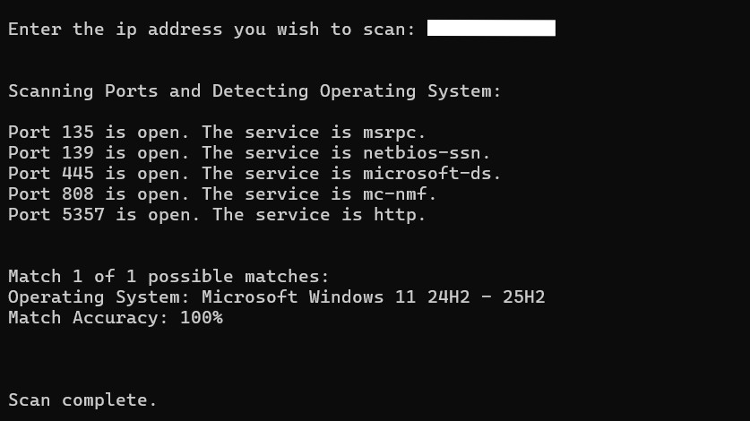
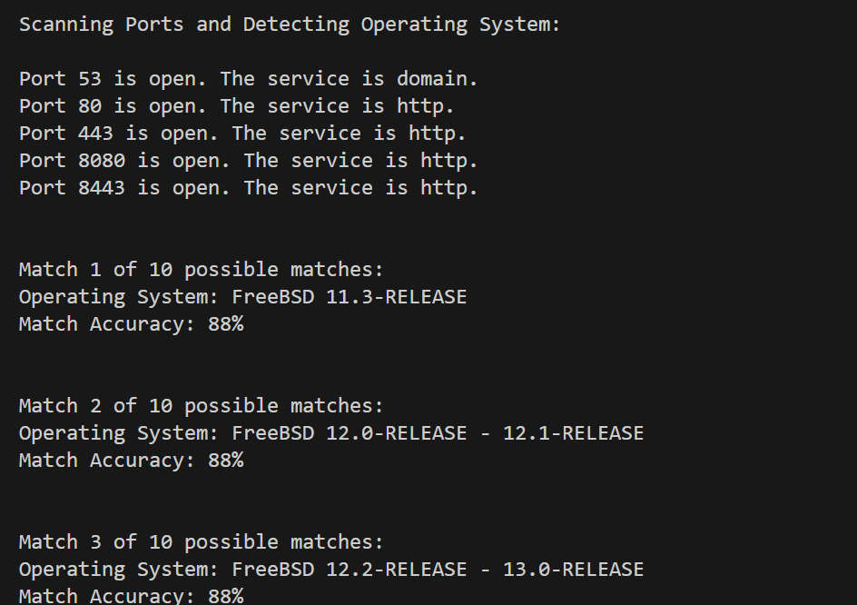
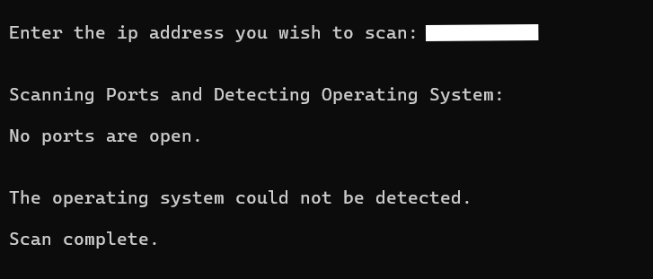
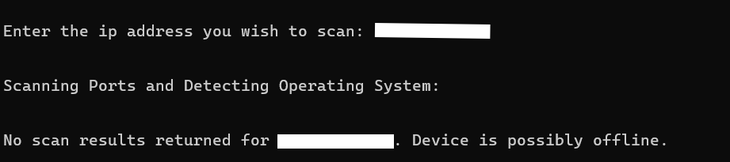

# IP Port Scanner and Operating System Detection

## Project Overview

This program uses the Python-Nmap library, and a user-supplied
target IP address to scan the top 1000 TCP ports and identify open ports
and detect the operating system.

The user is prompted for an ip_address in the terminal. The scan results,
including port states, services running, and possible operating system matches are then displayed in the terminal.

## Features
- Accepts a user supplied target IP address
- Scans the top 1000 TCP ports.
- Identifies open ports and services running
- Attempts operating system detection
- Displays scan results in the terminal

## Requirements

This program requires the following:

1. `Python:` This can be installed at https://www.python.org/downloads/ Check any option given to add to PATH or manually add to PATH.
2. `Python-Nmap Library:` This is the library that allows python to communicate with the Nmap application. It can be installed in the terminal:
    - Windows Users: python -m pip install -r requirements.txt
    - Other Operating System Users: python3 -m pip install -r requirements.txt
3. `Nmap Application:` This is the actual scanning application that scans the target IP address. This can be installed at https://nmap.org/download.html Check any option given to add to PATH or manually add to PATH.
4. `Npcap:` This separate application is required for Windows operating systems, to support packet capturing, but it is offered as part of the Nmap Application installation.

## How to Run the Program

1. Install the above requirements.
2. Navigate into the ip_port_scanner folder/directory in your terminal.
3. Run the program:
    - Windows Users: python port_scanner.py
    - Other Operating System Users: python3 port_scanner.py

## Nmap Scan Arguments

The following code uses the Python-Nmap library to initiate the scan:
`scanner.scan(target_ip, arguments = "-Pn -sV -O")`

- `scanner` is a `PortScanner()` object.
- The `.scan()` method is used on the `PortScanner` object to initiate the Nmap scan.
- The `target_ip` parameter supplies the IP address to be scanned.
- The `arguments` parameter specifies which Nmap flags are used to determine the type of scan performed:
    - The `-Pn` argument is used to skip discovery and treat the `target_ip` as online. This allows for port scanning even if the target is blocking the ping, for example with a firewall.
    - The `-sV` argument is used for service and version detection.
    - The `-O` argument is used for operating system detection.

## Understanding the Results

The service information reported by Nmap is the application detected to be running on that port, but it is not alays definitive. The operating system accuracy percentages represent Nmap's internal confidence in that operating system match, but they are estimates and do not necessarily total 100%.

## Limitations

Nmap's operating system detection works best when there is at least one open and one closed port detected. Firewalls can filter or block the scan traffic, and port detection or operating system detection are not guaranteed.

## Screenshots and Results

Screenshots of the scan results can be found below or in the screenshots folder:
- Successful Scan:

- Multiple Possible Operating System Matches:

- Partial Results (No Ports Open but no Operating System Information Detected):

- Unsuccessful Scan:

## Responsible Use

This scanner should only be used against systems you own or have explicit permission to test.